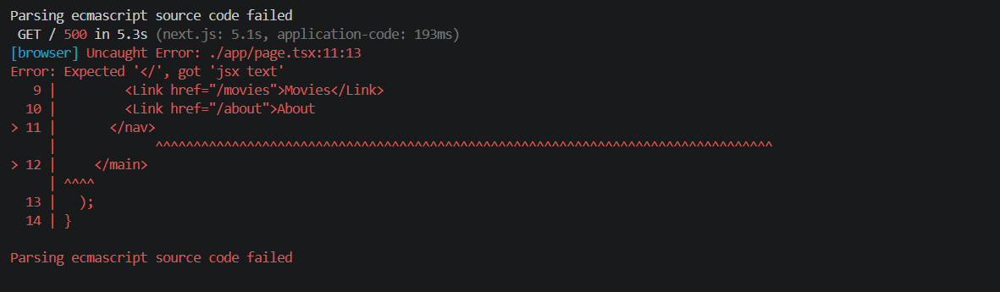

# Session 1 lab handout: From React SPA to Next.js

Full-Stack Frameworks and Server-Side Rendering, EPITA Bachelor in Computer Science, L3

This session you build Movie Night, a small Next.js app, in two labs. Then you start your own project.

| Time | Block |
|---|---|
| +0:00 | Lab 1: Scaffold and explore (60 min) |
| +1:00 | Break (10 min) |
| +1:10 | Lab 2: First server-rendered page (70 min) |
| +2:20 | Project kickoff (25 min) |
| +2:45 | Wrap-up and exit quiz (15 min) |

## Before you start

* Node.js 24 LTS (Node.js 26 also works): check with `node -v`
* Git, VS Code, and a recent Chrome or Edge
* Git configured with your name and email: `git config user.name` and `git config user.email` must print something. If not, set them with `git config --global user.name "Your Name"` and `git config --global user.email "you@example.com"`.
* The link to the `lab-files` folder, given by the teacher. It contains every file of the labs and the proposal template.

Two rules for the whole afternoon:

* Cache Components must stay off. `next.config.ts` must not contain `cacheComponents`.
* `npm run dev` renders every page on every request. To see static, dynamic and ISR behaviour, run `npm run build`, then `npm start`.

| Build output | Meaning |
|---|---|
| `○ (Static)` | Prerendered at build time. With a value in the Revalidate column: ISR |
| `ƒ (Dynamic)` | Rendered on the server for each request |

---

## Lab 1: Scaffold and explore (60 min)

Goal: create a Next.js app, understand every file that `create-next-app` generates, and add your first pages. The lab app is called Movie Night: a small site to choose the movie for a student movie night.

### Step 1: Create the project (10 min)

```bash
npx create-next-app@16.4.0 movie-night
```

Answer the questions like this. The first question is a menu: press the down arrow twice to select "No, customize settings", then press Enter.

| Question | Answer |
|---|---|
| Would you like to use the recommended Next.js defaults? | No, customize settings |
| Would you like to use TypeScript? | Yes |
| Which linter would you like to use? | ESLint |
| Would you like to use React Compiler? | No |
| Would you like to use Tailwind CSS? | Yes |
| Would you like your code inside a `src/` directory? | No |
| Would you like to use App Router? (recommended) | Yes |
| Would you like to use Cache Components? | **No** |
| Would you like to customize the import alias (`@/*` by default)? | No |
| Would you like to include AGENTS.md to guide coding agents to write up-to-date Next.js code? |  Yes |
| Would you like to help improve Next.js by letting agents prepare anonymized feedback for your review as you code? | **No** |

Check the two answers in bold before you press Enter. Agent feedback is always pre-selected on Yes. Cache Components is pre-selected from your previous `create-next-app` runs, and on Yes if you never ran it. If you press Enter on every question, Cache Components can be turned on. For each Yes / No question, switch with the left and right arrow keys, then press Enter.

**Do not choose "Yes, use recommended defaults"**: the defaults turn Cache Components on. Do not choose "No, reuse previous settings" either: it reuses the answers of your previous run, which may turn Cache Components on.

Equivalent one-line command:

```bash
npx create-next-app@16.4.0 movie-night --yes --no-cache-components --no-agent-feedback
```

Careful: as soon as you pass any option on the command line, `create-next-app` stops asking questions and uses the defaults for everything you did not specify. With `--yes` alone, Cache Components is turned on, unless a previous run saved another answer. 
Either pass no option at all (and answer the questions), or use the full command above.

At the end, the output must contain `Initialized a git repository.` If it does not, your project has no Git repository: see the table of common errors at the end.


### Step 2: Run the dev server (5 min)

```bash
cd movie-night
npm run dev
```

Open http://localhost:3000. Keep the terminal visible: the server logs appear there.

Open the `movie-night` folder in VS Code.

### Step 3: Tour of the project (10 min)

| Path | Role |
|---|---|
| `app/` | The routes of the app. Each folder is a URL segment. |
| `app/layout.tsx` | Root layout. Required. Contains `<html>` and `<body>` and wraps every page. |
| `app/page.tsx` | The page for the URL `/` |
| `app/globals.css` | Global styles. Imports Tailwind CSS. |
| `app/favicon.ico` | The favicon. Next.js serves it automatically. |
| `public/` | Static files served as they are from the root URL: `public/next.svg` is available at `/next.svg` |
| `next.config.ts` | Next.js configuration. Here it only tells Turbopack how to process Tailwind CSS. |
| `tsconfig.json` | TypeScript configuration. Defines the `@/*` alias. |
| `eslint.config.mjs` | ESLint configuration with the Next.js rules |
| `next-env.d.ts` | Type declarations for Next.js. Generated, do not edit. |
| `.gitignore` | Git files and folders to ignore |
| `package.json` | Dependencies and scripts |
| `.next/` | Build output. Generated, ignored by Git. |

The scripts in `package.json`:

| Command | What it does |
|---|---|
| `npm run dev` | Development server with Turbopack and fast refresh. Renders every page on every request. Shows errors in an overlay. |
| `npm run build` | Production build: type checking, compilation, prerendering of static pages. Prints the route table. |
| `npm start` | Serves the last production build from `.next/`. Requires `npm run build` first. |
| `npm run lint` | Runs ESLint. Since Next.js 16, `next build` no longer runs the linter. |

Answer these questions in a `NOTES.md` file at the root of the project:

1. In which file are the `<html>` and `<body>` tags?
2. Which file renders the page at `/`?
3. Which folder is for images and other static files, and how do you reference them?
4. What is  `tsconfig.json ` doing in your project?
5. What does `@/*` mean in `tsconfig.json`? Write an import that uses it.
6. What does `app/layout.tsx` import from `next/font/google`, and what does Next.js do with it at build time?
7. What’s the difference between `layout.tsx` and `page.tsx`? 
8. Where would you put a navbar that appears on every page?
9. What is `globals.css` for, and where is it imported?
10. What is `AGENTS.md`, and does your app need it to run?

### Step 4: Edit the home page (5 min)

Replace the content of `app/page.tsx`:

```tsx
import Link from "next/link";

export default function Home() {
  return (
    <main className="mx-auto w-full max-w-2xl p-8">
      <h1 className="text-3xl font-bold">Movie Night</h1>
      <p className="mt-2">Pick the movie for our next movie night.</p>
      <nav className="mt-6 flex gap-4 underline">
        <Link href="/movies">Movies</Link>
        <Link href="/about">About</Link>
      </nav>
    </main>
  );
}
```

Save and watch the browser update without a full reload (fast refresh). 
`<Link>` works like the `Link` of React Router, but takes `href` instead of `to`. 
Session 3 covers it in detail. The `/movies` page does not exist yet: you build it in Lab 2.

### Step 5: Add an About page with metadata (10 min)

Create `app/about/page.tsx`:

```tsx
import type { Metadata } from "next";

export const metadata: Metadata = {
  title: "About | Movie Night",
  description: "What Movie Night is and how it works",
};

export default function AboutPage() {
  return (
    <main className="mx-auto w-full max-w-2xl p-8">
      <h1 className="text-3xl font-bold">About</h1>
      <p className="mt-2">
        Movie Night is a small app built during session 1 of the Next.js course.
      </p>
    </main>
  );
}
```

Open http://localhost:3000/about. Check the title in the browser tab, then open `view-source:` and find the `<title>` and `<meta name="description">` tags in the HTML.

or you can use this command in your terminal

**curl** shows exactly what the server sends, before any JavaScript runs.

`curl -s http://localhost:3000/about | grep -o '<title>[^<]*</title>' ` \
`curl -s http://localhost:3000/about | grep -o '<meta [^>]*' `

Then open `app/layout.tsx` and change the default metadata:

```tsx
export const metadata: Metadata = {
  title: "Movie Night",
  description: "Pick the movie for our next movie night",
};
```

The home page now uses this default title from the layout. The About page defines its own, so it replaces the default.

### Step 6: Break things on purpose (5 min)

* Delete a closing tag in `app/page.tsx` and save. Read the error overlay: which file and line does it point to? Fix it and watch the overlay disappear without a manual refresh.

* Open http://localhost:3000/nope. Next.js shows its built-in 404 page.
* Rename `app/page.tsx` to `app/home.tsx`. What happens to `/`? Rename it back. The route will stop working and get 404 

### Step 7: Commit (5 min)

`create-next-app` already initialised a Git repository and made a first commit: `git log --oneline` shows it.

```bash
git add .
git commit -m "Lab 1: home and about pages"
```

### Lab 1 checkpoint

* [ ] The app runs with `npm run dev`
* [ ] Cache Components are off: `next.config.ts` does not contain `cacheComponents`
* [ ] `/` shows the Movie Night home page with two links
* [ ] `/about` works and its `<title>` is visible in the page source
* [ ] `NOTES.md` answers the six questions of step 3
* [ ] The work is committed

---

## Lab 2: First server-rendered page (70 min)

Goal: list movies on a page rendered on the server, prove that it is rendered on the server, observe the difference between static and dynamic rendering in production, and compare with a client-rendered version of the same page.

Copy the code from the `lab-files` folder shared by the teacher. Copying from a rendered page or a PDF can break quotes and indentation.

### Part A: The data (10 min)

Create `data/movies.json` at the root of the project:

```json
[
  { "id": 1, "title": "Spirited Away", "year": 2001, "genre": "Animation", "minutes": 125 },
  { "id": 2, "title": "Inception", "year": 2010, "genre": "Sci-Fi", "minutes": 148 },
  { "id": 3, "title": "Parasite", "year": 2019, "genre": "Thriller", "minutes": 132 },
  { "id": 4, "title": "Amélie", "year": 2001, "genre": "Comedy", "minutes": 122 },
  { "id": 5, "title": "Interstellar", "year": 2014, "genre": "Sci-Fi", "minutes": 169 },
  { "id": 6, "title": "Coco", "year": 2017, "genre": "Animation", "minutes": 105 }
]
```

Create `lib/movies.ts`. The one second delay simulates a slow database query:

```ts
import movies from "@/data/movies.json";

export type Movie = {
  id: number;
  title: string;
  year: number;
  genre: string;
  minutes: number;
};

// Simulates a slow database query (1 second)
export async function getMovies(): Promise<Movie[]> {
  await new Promise((resolve) => setTimeout(resolve, 1000));
  return movies;
}
```

Create `components/movie-list.tsx`. It is a plain React component, reused in Part F:

```tsx
import type { Movie } from "@/lib/movies";

export function MovieList({ movies }: { movies: Movie[] }) {
  return (
    <ul className="mt-6 space-y-3">
      {movies.map((movie) => (
        <li key={movie.id} className="rounded border p-4">
          <h2 className="font-semibold">
            {movie.title} ({movie.year})
          </h2>
          <p className="text-sm">
            {movie.genre} · {movie.minutes} min
          </p>
        </li>
      ))}
    </ul>
  );
}
```

### Part B: The server-rendered page (15 min)

Create `app/movies/page.tsx`:

```tsx
import type { Metadata } from "next";
import { MovieList } from "@/components/movie-list";
import { getMovies } from "@/lib/movies";

export const metadata: Metadata = {
  title: "Movies | Movie Night",
  description: "The movies you can vote for",
};

export default async function MoviesPage() {
  const movies = await getMovies();
  console.log(`[movies] rendered ${movies.length} movies`);

  return (
    <main className="mx-auto w-full max-w-2xl p-8">
      <h1 className="text-3xl font-bold">Movies</h1>
      <p className="text-sm text-zinc-600 dark:text-zinc-400">
        Rendered at {new Date().toISOString()}
      </p>
      <MovieList movies={movies} />
    </main>
  );
}
```

What is new compared with the SPA:

* The component is `async` and awaits its data directly. No `useEffect`, no `useState`, no loading state.
* It is a Server Component, the default in the App Router: it runs on the server only.
* `getMovies()` could query a database directly, because this code never reaches the browser.

With `npm run dev` still running, open http://localhost:3000/movies. The page takes about one second to load in development: that is the simulated query. The first load can take longer, while Next.js compiles the page.

### Part C: Prove that it is rendered on the server (10 min)

1. Open `view-source:http://localhost:3000/movies` and search for "Inception". The titles are in the HTML sent by the server.
2. Open DevTools (F12, or Cmd+Option+I on macOS). Press Cmd+Shift+P (Ctrl+Shift+P on Windows), type "Disable JavaScript", press Enter, then reload. The list is still there. Enable JavaScript again the same way, with "Enable JavaScript".
3. Look at the terminal running `npm run dev`: `[movies] rendered 6 movies` is printed there, by Node.js, once per request. In development, the browser console may also show a copy marked "Server". It is only a debugging aid: the code still ran on the server. In production the log only appears on the server.

### Part D: Production build: static by default (15 min)

Stop the dev server with Ctrl+C (on Windows, answer Y if the terminal asks "Terminate batch job (Y/N)?"), then:

```bash
npm run build
```

Read the route table at the end of the output:

```
Route (app)
┌ ○ /
├ ○ /_not-found
├ ○ /about
└ ○ /movies

○  (Static)  prerendered as static content
```

`/movies` is static: Next.js rendered it once, during the build. Scroll up in the build log: your `console.log` ran during the build.

Start the production server:

```bash
npm start
```

Open http://localhost:3000/movies and refresh several times:

* The page loads instantly. The one second delay happened once, at build time, not for each visitor.
* The "Rendered at" timestamp never changes. It is the time of the build.
* Nothing new is printed in the terminal.

This is SSG: the HTML was produced at build time. Next.js labels it "(Static)" because `/movies` has a fixed URL. The label "(SSG)" with ● is only used for pages of a dynamic segment such as `/movies/[id]`, prerendered with `generateStaticParams` (sessions 2 and 3).

### Part E: Make it dynamic (10 min)

Stop the server. Add this line to `app/movies/page.tsx`, just below the imports:

```tsx
export const dynamic = "force-dynamic";
```

Rebuild and start again:

```bash
npm run build
npm start
```

* The route table now shows `ƒ /movies` (Dynamic rendering, server-rendered on demand).
* Each refresh takes about one second, shows a new timestamp, and prints the log line in the terminal.

This is SSR: fresh on every request, but every visitor waits for the data.

### Part F: The same list, rendered in the browser (10 min)

Stop the production server (Ctrl+C). Copy `data/movies.json` into the `public/` folder, where the browser can download it. It plays the role of a separate API. In VS Code, right-click the file, choose Copy, then right-click `public/` and choose Paste. On macOS, Linux or Windows PowerShell you can also run:

```bash
cp data/movies.json public/movies.json
```

Create `app/movies-client/page.tsx`:

```tsx
"use client";

import { useEffect, useState } from "react";
import { MovieList } from "@/components/movie-list";
import type { Movie } from "@/lib/movies";

export default function MoviesClientPage() {
  const [movies, setMovies] = useState<Movie[] | null>(null);

  useEffect(() => {
    // Runs in the browser, after the page has loaded
    fetch("/movies.json")
      .then((res) => res.json())
      .then((data: Movie[]) => setMovies(data));
  }, []);

  return (
    <main className="mx-auto w-full max-w-2xl p-8">
      <h1 className="text-3xl font-bold">Movies (client-rendered)</h1>
      {movies === null ? <p className="mt-6" role="status">Loading movies...</p> : <MovieList movies={movies} />}
    </main>
  );
}
```

`"use client"` marks a Client Component: its code is sent to the browser, so it can use hooks like `useState` and `useEffect`. Session 3 explains it in detail.

Run `npm run dev` and open http://localhost:3000/movies-client, then:

* `view-source:`: the HTML contains "Loading movies..." but no movie title.
* With JavaScript disabled: the page stays on "Loading movies...".
* Network tab: `movies.json` is requested after the JavaScript has run. In development you see the request twice: React Strict Mode runs effects twice in development to help find bugs. In production it happens once.

Careful with a common misconception: a Client Component is not "rendered only in the browser". Next.js also prerenders it to HTML on the server, which is why "Loading movies..." is in the page source. What runs only in the browser here is the `useEffect`, so the data arrives only in the browser.

The same `MovieList` component is rendered on the server in `/movies` and in the browser in `/movies-client`. The component did not change. Only where and when it renders changed.

### Questions

Add your answers to `NOTES.md`. Answer them while your builds run, and finish at home before session 3 if needed:

1. In the page source, are the movie titles present for `/movies`? For `/movies-client`? Why?
2. Without the `force-dynamic` line of Part E, you run `npm run build` again tomorrow, then `npm start`, without changing anything else. What does the "Rendered at" timestamp of `/movies` show, and why?
3. Part E made every request to `/movies` about one second slower. Give one situation where `force-dynamic` is still the right choice, and explain why.
4. A classmate sees `[movies] rendered 6 movies` in the browser console and says: "So this code runs in the browser." What do you answer, and how can you prove it?
5. Which version would you choose for a public movie catalogue that changes once a week, and why?

### Commit

```bash
git add .
git commit -m "Lab 2: server and client movie pages"
```

### Stretch goals

* S1, ISR: in `app/movies/page.tsx`, replace `export const dynamic = "force-dynamic";` with `export const revalidate = 10;`. Build and read the route table: `/movies` is static again, with `10s` in the Revalidate column. Start the server and refresh several times over 30 seconds. Explain the pattern of timestamps. Hint: right after the 10 seconds have passed, the first refresh still shows the old timestamp. In the Network tab, look at the `x-nextjs-cache` response header.
* S2, Lighthouse: run `npm run build` again, so that the build includes `/movies-client`, then `npm start`. Run Lighthouse (mobile) on `/movies` and on `/movies-client`. Compare FCP and LCP. Then compare the SEO scores and explain why they are almost the same.
* S3, port a page: move one page of your Front-End Frameworks SPA into a Next.js page. List what you had to change (data fetching, routing, styles).
* S4, offline docs: browse `node_modules/next/dist/docs/` and find the page that documents `export const revalidate`.

### Lab 2 checkpoint

* [ ] `/movies` lists 6 movies and the titles are in the page source
* [ ] You saw `/movies` as ○ in the build output, then as ƒ after adding `force-dynamic`
* [ ] You observed the timestamp frozen (static) and changing (dynamic) under `npm start`
* [ ] `/movies-client` shows "Loading movies..." in its page source
* [ ] `NOTES.md` answers the five questions
* [ ] The work is committed

---

## Project kickoff (25 min)

### The brief

You will build one full-stack web application during the course, alone. Each milestone adds a layer:

| When | What your app must have |
|---|---|
| Start of session 3 | Proposal validated by the teacher |
| End of session 4 (Milestone 1) | At least three routes, a shared layout, at least one dynamic segment (`[slug]` or `[id]`) |
| Sessions 7, 8 (Milestone 2) | At least two API routes (one read, one write) used by the front end, with loading and error handling |
| Sessions 9, 10 (Milestone 3) | A database (Prisma) behind the API routes, all CRUD operations, code pushed to the repository |
| Session 12 | Deployed on Vercel, presented in 10 to 15 minutes |

### Constraints on the topic

* Original: not Campus Events (the teacher's demo) and not Movie Night (the lab).
* At least two kinds of data linked by a relation (for example recipes and reviews). You need it for Prisma in session 5.
* At least one public page that benefits from SEO, and at least one action that writes data.
* Small enough to finish: 3 to 6 pages.
* No login required. Authentication is not part of this course.

Ideas: recipe book with reviews, book club, sports league results, student marketplace, travel journal, bug tracker, workout log, concert listings, plant care tracker, board game collection.

### Proposal (due at the start of session 3, ungraded)

Before session 3:

1. Scaffold your project in a new folder next to `movie-night`, not inside it, with the same command as Lab 1 (Cache Components off) and your project name instead of `movie-night`.
2. On GitHub, create an empty private repository: no README, no `.gitignore` and no licence, otherwise your first push is rejected. Then, in your project folder:

   ```bash
   git remote add origin https://github.com/<your-username>/<your-repository>.git
   git push -u origin HEAD
   ```

   In the repository settings on GitHub, add the teacher ([teacher's GitHub username]) as a collaborator.
3. Add a `PROPOSAL.md` file at the root of the project (the template is also in `lab-files/PROPOSAL.md`), commit and push it:

```md
# Project proposal

* Name:
* Project title:
* Pitch (one sentence):
* Target users:

## Pages

| URL | Content | Dynamic segment? | Rendering strategy and why |
|---|---|---|---|
| / | | | |

## Data

Entities (2 to 4), their main fields, and how they are related:

## Write actions

What users can create, update or delete:

## Repository

GitHub URL:
```

---

## When something goes wrong

| Symptom | Cause | Fix |
|---|---|---|
| `next.config.ts` contains `cacheComponents: true`, or the build fails with ``Route segment config "dynamic" is not compatible with `nextConfig.cacheComponents`. Please remove it.`` | Chose "recommended defaults", pressed Enter on the Cache Components question, or passed some options to `create-next-app` without `--no-cache-components` | Remove the `cacheComponents: true` and `partialPrefetching: true` lines from `next.config.ts`, or recreate the project |
| `npm start` fails with `Error: Could not find a production build in the '.next' directory. Try building your app with 'next build' before starting the production server.` | `npm start` serves the content of `.next/` | Run `npm run build` first |
| Changes do not appear under `npm start` | The server serves the previous build | Stop it, run `npm run build`, start again |
| The timestamp of a static page changes on every refresh | You are in `npm run dev`, which renders on every request | Use `npm run build` then `npm start` |
| Build or overlay error: ``You're importing a module that depends on `useState` into a React Server Component module. This API is only available in Client Components.`` | Hooks used in a Server Component | Add `"use client"` at the top of the file (explained in session 3) |
| Build fails with `You are attempting to export "metadata" from a component marked with "use client", which is disallowed.` | The page is marked `"use client"` | Keep the page a Server Component and move the interactive part to a separate Client Component file, or set the metadata in a layout |
| ESLint error `react/no-unescaped-entities` | An apostrophe or quote directly in JSX text | Rephrase, or write `&apos;` |
| 404 on `/movies` | Wrong file location, such as `app/movies.tsx` | The file must be `app/movies/page.tsx` |
| Works on macOS or Windows, 404 after deployment | Folder names are case sensitive on Linux servers: `app/Movies/` is `/Movies`, not `/movies` | Use lowercase folder names |
| `Module not found` for an `@/...` import | Wrong path after the alias | `@/` is the project root: `@/lib/movies` is `lib/movies.ts` |
| Code from a tutorial uses `pages/`, `getStaticProps` or `getServerSideProps` | Pages Router tutorial | Use the App Router docs |
| Code from a tutorial uses `"use cache"` or `cacheLife` | Cache Components tutorial | Use `dynamic` and `revalidate` |
| `git commit` fails with `fatal: not a git repository (or any of the parent directories): .git`, or `create-next-app` did not print `Initialized a git repository.` | Git refused the first commit, so `create-next-app` removed the repository. This happens when your Git name or email is not set and Git cannot guess an address from the computer name. Or the project is inside another Git repository | Set `git config --global user.name` and `git config --global user.email`. Move the project out of the other repository if needed. Then, in the project: `git init`, `git add .`, `git commit -m "Initial commit"` |
| On Windows, PowerShell refuses `npx` or `npm` with "running scripts is disabled on this system" | The PowerShell execution policy blocks the `.ps1` scripts installed with Node.js | Use Command Prompt or Git Bash, or run `Set-ExecutionPolicy -Scope CurrentUser RemoteSigned` once in PowerShell |
| Port 3000 already in use | Another dev server is still running | Stop it, or read the URL printed in the terminal |
| The install ends with "5 high severity vulnerabilities" | On 11 October 2026, all 5 come from `braces`, used by the ESLint configuration for Next.js (`eslint-config-next`, through `fast-glob` and `micromatch`). It is a development tool. `npm audit --omit=dev` finds 0 vulnerabilities in the packages of the app itself (`next`, `react`, `react-dom`). | Nothing to do for the course. Do not run `npm audit fix --force`: it can install breaking major versions and break the project. |

